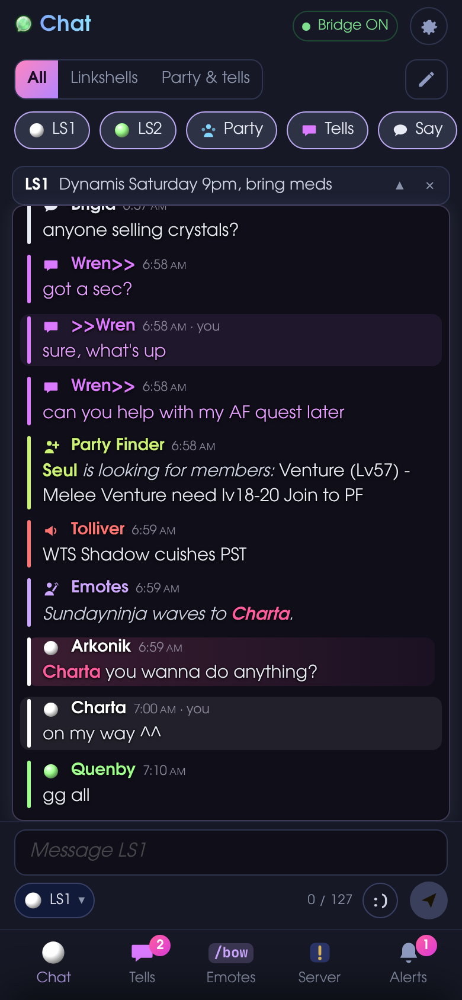

<p align="center"></p>

> [!NOTE]
> **v1.1.0 was reviewed by CatsEyeXI staff and approved** (November 2026). v1.1.1 builds on it with fixes, looks and a few phone-side features. It sends the same lines and reads nothing new, so it hasn't been back to staff. It's the version to use. See the [changelog](CHANGELOG.md).

# phonechatXI

A second chat window for FFXI on CatsEyeXI, on your phone.

Typing with a controller is slow, and the chat log is hard to read on a Steam Deck. phonechatXI shows your chat on your phone and lets you reply with the phone's keyboard while you keep playing.

There are three parts:

- `phonechat`, an Ashita v4 addon. It writes chat to a file and types the lines you send.
- The bridge, a small Python program that runs on the same machine as the game and serves the phone page. It comes in the addon zip, and the addon starts it for you.
- The phone page. Add it to your Home Screen and it opens like an app.

**You need:**

- The CatsEye launcher (Ashita v4). VanaCore's beta works too on Windows.
- Python 3.7 or newer. The Steam Deck already has it; on Windows, see Install.
- A phone on the same Wi-Fi as the game.

Tested on a Steam Deck and on Windows 11, with an iPhone.

**Made for phones.** The idea is to pair the game with the phone in your hand: play on the handheld or PC, read and type on the phone. The page also opens in a desktop or tablet browser, but the layout is built for a phone screen, and that's what gets tested.

<p>
  
  
  
</p>

## Features

- LS1, LS2, party, tells, say, shout, unity, yell, emotes and Party Finder in one feed, colored like the game.
- Views, like the game's chat windows. All, Linkshells and Party & tells are built in, and you can add your own.
- A Tells tab with a thread per person.
- Tap a name to start a tell, or a line to reply on its channel. Nothing sends until you press send.
- Linked items (`{{Suppanomimi}}`) open a BG-Wiki search. Web addresses in chat show as plain text.
- Mentions: your name or nicknames (up to 3) are highlighted in chat and collected in Alerts. Emotes and yell don't count.
- The LS message of the day is pinned above chat, with an × to hide it.
- An Emotes tab with the stock emotes, plus dances, chair poses and job emotes.
- A Server tab with every CatsEye `!` command in a searchable list, filterable by game mode (ACE, CW, WEW). Star the ones you use. Tapping one asks before it sends, starred ones too.
- An Alerts tab: a card per VNM or HVNM with a 10 minute countdown from Populox's first message, then POP!, plus your mentions, server notices and (if you turn it on) bazaar visits. VNM cards, notices and bazaar visits clear with ×.
- A `:)` button with your own list of text emoticons. Set them in Settings, or keep the eight defaults.
- The keyboard doesn't capitalize or autocorrect, so game words like Jeuno or Windurst come through as you typed them. Both can be turned on in Settings.
- Four skins (Classic, Midnight, Onyx and Yunas, an unofficial look inspired by YunaUI), two fonts, a compact layout, text size, 12 or 24-hour time and per-channel colors. Settings are saved on the bridge and can be exported (without your mention names).

<p>
  
  
  
  
</p>

<p>
  
  
  
</p>

<sub>Screenshots are made with made-up chat by `tools/screenshots.py`.</sub>

## What it won't do

- Automate anything. Every line, emote or command is one tap from you. No auto-replies, repeats or macros, and nothing is sent on a timer or in reaction to chat. Mentions only highlight, and the VNM countdown only shows on your phone.
- Take game actions. `/ma`, `/ja`, `/ws`, `/item`, `/attack`, `/follow`, targeting and movement are blocked, and so are target tokens like `<st>` in a chat line.
- Use `/yell`.
- Split messages. One tap sends one line of 130 bytes at most, counted on the whole typed line (so about 127 letters on a linkshell, fewer for a tell or Japanese text), and no more than one line per second.
- Read the combat log.
- Read other addons. Lines they print are ignored, the ventures addon's included.
- Go online. There's no cloud or outside server. The only outside page is BG-Wiki, when you tap an item.

What it can send is a fixed list: `/l`, `/l2`, `/p`, `/t`, `/s`, `/sh`, the stock emotes, and the `!` commands in [`bridge/commands.json`](bridge/commands.json). The bridge checks every line, and the addon checks it again against the same list right before typing it. The addon's check is `allowed()` in [`phonechat.lua`](addon/phonechat/phonechat.lua).

## New in 1.1.1

- The Yunas skin, an unofficial look inspired by YunaUI.
- VNM and HVNM cards count down from Populox's first message, show POP!, and stack when several run at once.
- A full-width message box that grows as you type. Unsent text stays put when you switch channels.
- Tells in chat read like the game (`Wren>>`, `>>Wren`).
- The LS1 message of the day shows in full, and you can set your own `:)` emoticons.

The full list, and what 1.1.0 added, is in the [changelog](CHANGELOG.md).

## Install

Download the latest `phonechatXI-v1.1.x.zip` from [Releases](../../releases). It's under Assets; the "Source code" downloads are the whole repo, not the addon.

### Steam Deck

1. In the CatsEye launcher, use Add New Addon, pick the zip and turn it on.
2. Start the game and type `/pchat`. Click **Start** in the phonechatXI window, and tick **Start with the game** to skip this next time.
3. Scan the QR code with your phone's camera and open the link. In Safari, tap Share, then Add to Home Screen.

The bridge runs in the background; the `/pchat` window shows whether it's on. It's copied to `~/phonechat/` (`/home/deck/phonechat/`) the first time it starts. To run it from Desktop Mode, use the phonechatXI Bridge launcher in that folder.

### Windows

1. Install Python 3 from [python.org](https://www.python.org/downloads/) (any version from 3.7 up). Say yes when it offers to add Python to your PATH. Then close and reopen the CatsEye launcher, so the game sees Python.
2. In the CatsEye launcher, use Add New Addon, pick the zip and turn it on.
3. In game, type `/pchat` and click **Start**. A small "phonechatXI bridge" window opens minimized next to the game. That's the bridge; leave it open. If Windows asks about the firewall, allow private networks.
4. Scan the QR code in the phonechatXI window with your phone's camera, then add the page to your Home Screen.

The addon puts the bridge in `<Ashita>\config\addons\phonechat\` (on VanaCore, `<VanaCore>\config\addons\phonechat\`), so you never move files by hand. Ashita and VanaCore each keep their own copy and phone link.

### Updating

1. Close the game.
2. In the CatsEye launcher, remove phonechat, then use Add New Addon and pick the new zip.
3. Start the game and the bridge as usual. The bridge updates itself.

Removing the addon doesn't lose anything. Your link, settings and saved tells live in the phonechat folder (`~/phonechat/` on the Deck, `<Ashita>\config\addons\phonechat\` or VanaCore's on Windows), outside the addon folder. The phone page updates itself. For a new Home Screen icon, remove the shortcut and add it again.

If an older bridge is still running (for example, started from Desktop Mode), the addon tells you a newer one came with the update. Run `/pchat stop`, then `/pchat start`.

### Uninstall

1. In game, `/pchat stop`. Then remove the addon in the launcher.
2. Delete the phonechat folder: `~/phonechat/` on the Deck, `<Ashita>\config\addons\phonechat\` on Windows (`<VanaCore>\config\addons\phonechat\` on VanaCore).
3. Remove the shortcut from your Home Screen.

## In-game commands

| Command | |
|---|---|
| `/pchat` | Opens the phonechatXI window: start and stop, QR code, new phone link, settings. Same as `/pchat config`. |
| `/pchat help` | Prints bridge status, your phone link and these commands. |
| `/pchat start`, `/pchat stop` | Starts or stops the bridge. |
| `/pchat url` | Prints the phone link. |
| `/pchat newlink` | Makes a new phone link. The old one stops working. |
| `/pchat debug` | Turns the debug log on or off: every line the game shows, with its mode number, in `debug-<Name>.log` in the phonechat folder (4 MB at most). It includes other players' chat, so share it privately. Your phone link is left out. |

`/pcxi` and `/phonechat` work too.

## How it works

```
game  ->  addon  ->  feed file    ->  bridge  ->  phone
phone ->  bridge ->  outbox file  ->  addon   ->  chat (one line per tap)
```

The addon writes chat lines to a feed file, and the bridge streams them to the phone. Lines you send go into an outbox file. The addon reads it and types each line through Ashita's command queue, the same as typing it yourself. No packet injection.

The bridge lives outside the addon folder, in the phonechat folder. On the Deck it's a Linux program, so it can't run from inside the game's folders, and keeping it separate means addon updates don't reset your phone link.

On Windows the bridge has its own small window, minimized next to the game. It shows your phone link and notes when the game or a phone connects. On the Deck it runs in the background and writes to `~/phonechat/bridge.log`. `/pchat stop` turns it off, and on Windows closing its window does too.

If the game closes or freezes, or the addon is unloaded, the bridge window and the phone say so after 10 seconds, and the bridge closes itself 90 seconds later unless the game comes back. A bridge that hasn't seen the game (started from Desktop Mode, say) stays open.

## Limits

- No push notifications. A page on your home network can't send them, so your phone won't buzz for tells.
- Safari pauses the page when the phone locks or you switch apps. It catches up when you come back, as long as the bridge kept running.
- The screen sleeps on its normal timer. Raise Auto-Lock in iPhone Settings to keep it on longer.
- If your router gives your Deck or PC a new address, the saved link breaks. Scan the QR code again, or reserve an address for it in your router (a DHCP reservation).
- One character at a time. If two characters are logged in and both have chat, sending pauses so a line can't come from the wrong one. It resumes about 5 minutes after only one has chat. If you dual-box, unload it on your other character with `/addon unload phonechat`.
- No emoji in game. A few common ones turn into text as you type; any others get a note above the box and are left out.
- Home Wi-Fi only. The link and chat aren't encrypted, so on public Wi-Fi anyone on the network could see them, and anyone with your link could read and send.

## Troubleshooting

| Problem | Fix |
|---|---|
| Phone says "Can't reach the bridge" or "Bridge offline" | Check the phone is on the same Wi-Fi and the bridge is on (`/pchat`). If your Deck or PC got a new address, scan the QR code again. On Windows, allow Python through the firewall on private networks. |
| Bridge won't start on the Deck | The `/pchat` window shows the error. The full log is `~/phonechat/bridge.log`. |
| Bridge won't start on Windows | The bridge window says why. Usually Python isn't installed or isn't on PATH. After installing it, close and reopen the CatsEye launcher so the game sees it. |
| "Port ... is already in use" | Another bridge is already running. `/pchat stop`, then `/pchat start`. On Windows you can also close the old bridge window. |
| Phone says "Waiting for the game" | Log in with the addon on. `/pchat` should open its window; if it doesn't, turn the addon on in the launcher. If you're logged in and it still waits, the bridge is watching a different folder: close the bridge and start it again from the game with `/pchat start`. |
| Phone says "No response from the game" | The game closed or froze, or the addon was unloaded. The bridge closes itself about 90 seconds later unless the game comes back (this is normal after quitting the game). |
| A line says "The game didn't confirm this one" | The game didn't echo it back within a few seconds. Check in game before sending it again. |
| A line shows a red error from the game | The game rejected it, usually a tell to someone offline or a party line with no party. The phone shows the game's own message. |
| "Sending is paused" | Two of your characters are logged in with phonechat. Log one out, or unload it there with `/addon unload phonechat`. Sending resumes about 5 minutes after the other one last had chat. |
| "Emotes and ! commands have their own tabs" | Chat lines can't start with `/` or `!` (apart from a lone `/`, `!`, `!!` or `!?`). Use the Emotes or Server tab. |
| Someone saw your link or QR code | Make a new link (see below). The old one stops working right away. |
| Page says "This link was replaced" | Scan the new QR code, then replace your Home Screen shortcut. |
| Something else | In Settings, tap Copy debug info and paste it into a [bug report](../../issues/new/choose) or the phonechatXI thread on the CatsEyeXI Discord. |

## Replacing your phone link

Only needed if someone saw your link or QR. Updates don't need a new link.

1. In game, open `/pchat` and click **New phone link** twice (the second click confirms), or type `/pchat newlink`.
2. Scan the new QR code and check that chat connects.
3. If you use a Home Screen shortcut, delete the old one and add the new link. Deleting a shortcut alone doesn't stop the old link working; only a new link does.

If your Deck or PC just got a new network address, you don't need a new link. Scan the current QR and remake the shortcut.

## Privacy

- Chat is held in the bridge's memory and is gone when it stops. On the way, it passes through a feed file, and lines you send pass through an outbox file, both in the phonechat folder. They're emptied the next time the bridge starts, and the addon also empties the feed file when it loads.
- Tells are saved only if you turn on Remember tells: the last 50 lines per person, on the bridge, deleted with Clear saved tells. No other chat is saved.
- Phone settings (views, colors, skins, favorites) are also saved on the bridge in `phone-settings.json`, so a new shortcut picks them up. No chat goes in that file. Your mention names, which tells you've read, who you last sent a tell to and the alerts you've cleared stay on the phone only. They're never sent to the bridge or put in an export file, so a new phone or shortcut needs your name typed again.
- Anyone on your Wi-Fi with your link can read and send, so keep it to yourself.
- Unsent text in the message box stays in the open page only. It's never saved or sent on its own.

## About the code

I built this with Claude. I designed it and tested every feature myself, and I've gone through the parts that decide what gets sent, but Claude wrote most of the code and I'm not a programmer by trade. I plan to use it daily and keep it working on CatsEye. If a server or Ashita update breaks it, I'll fix it when I can, but I can't promise how fast. It's all open source, so anyone can read it or pick it up.

### If you change it or fork it

You're welcome to. Please:

- **Test off the live server.** [`tools/`](tools) has a fake chat session and a replay of real `/pchat debug` logs, so you can run the addon and bridge without the game.
- **Get new features reviewed.** If your version reads or sends anything new, or does anything on its own, it's a new addon. Give it its own name and submit it to CatsEyeXI staff through a GM ticket before using it in game.
- **Approval doesn't carry over.** It covers the versions staff reviewed from this repo, not changed copies.

Not sure if a change counts? Ask staff first.

## Bugs and requests

phonechatXI is for chat: reading it on your phone and typing messages without fighting a controller. The emotes and server commands are there because staff reviewed them with 1.0.0, and that list isn't growing. There are no plans for more commands, addon controls or macros unless CatsEyeXI staff ask for them.

- Bugs: open a [bug report](../../issues/new/choose) or post in the phonechatXI thread on the CatsEyeXI Discord, and paste the text from Settings, Copy debug info. It doesn't include your phone link or any chat.
- Phone bugs come first. Something that only happens in a desktop or tablet browser may wait, so say which device and browser you're on.
- Requests are read, but most of my time goes to fixing bugs, so I can't promise a timeline. Anything that changes what it reads from the game or sends to it needs CatsEyeXI staff review first.

## Credits

- Built by Charta with Claude.
- `bridge/qrcode.js` is [qrcode-generator](https://github.com/kazuhikoarase/qrcode-generator) by Kazuhiko Arase (MIT).
- The in-game QR code uses [luaqrcode](https://github.com/speedata/luaqrcode) by speedata (BSD-3), in `addon/phonechat/qrencode.lua`.
- Yunas skin: Based on YunaUI by Yunas - https://github.com/YunasXI/yunaui
  Inspired by YunaUI and used with his OK. It's unofficial, so send any issues to Charta, **not Yunas**. It copies the look only and uses none of YunaUI's code or images.
- Fonts: Cinzel, Atkinson Hyperlegible and JetBrains Mono on the phone page, and Cormorant SC in the logo image, all under the SIL Open Font License. TeX Gyre Adventor, used in the Yunas skin, is under the GUST Font License and shipped unchanged. License files for the bundled fonts are in `bridge/fonts/`.
- The server command list and the game mode icons come from the [CatsEyeXI Commands](https://www.bg-wiki.com/ffxi/CatsEyeXI_Commands) page on BG-Wiki (as of October 2026).
