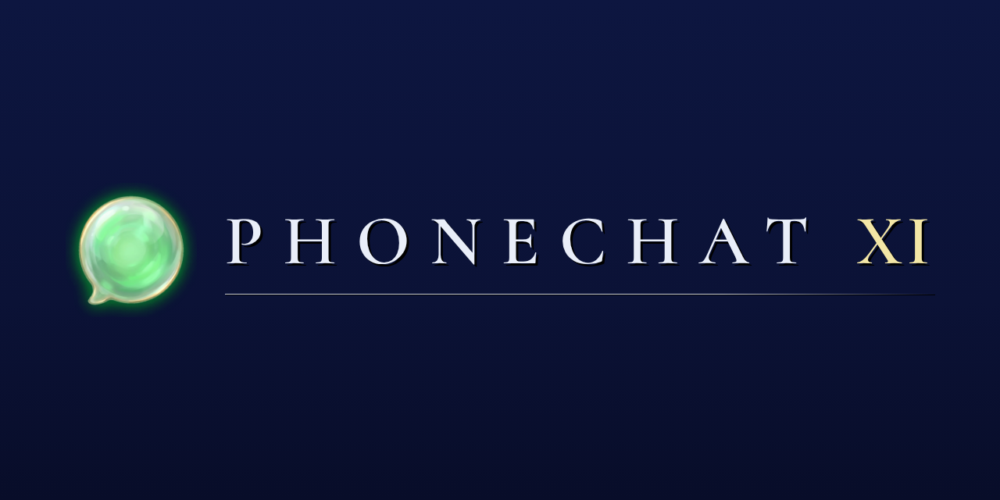
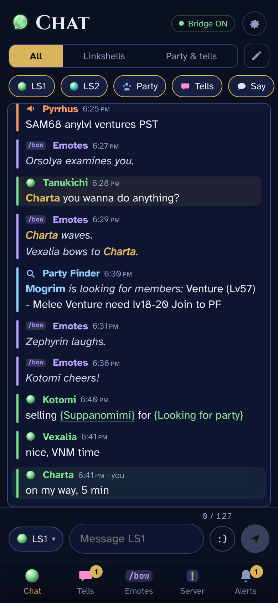
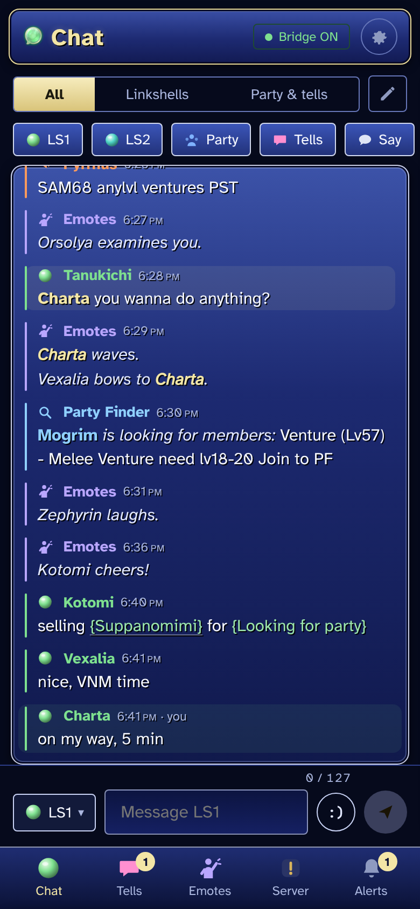
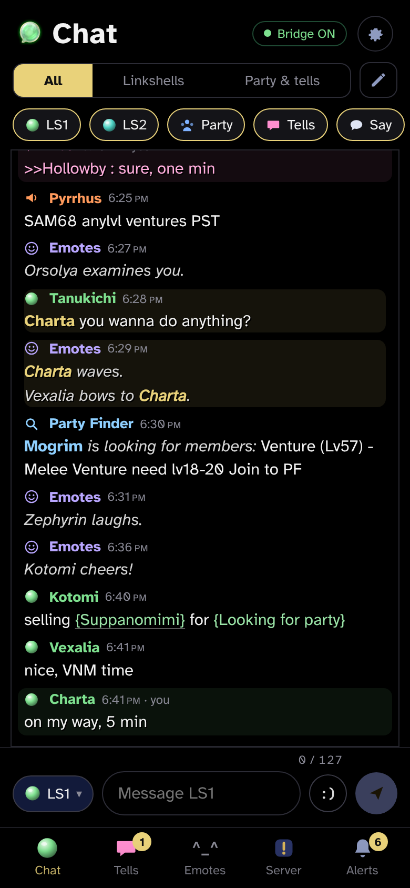
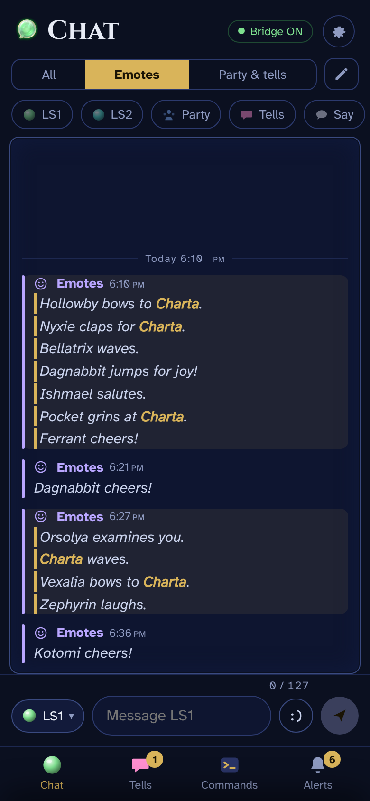
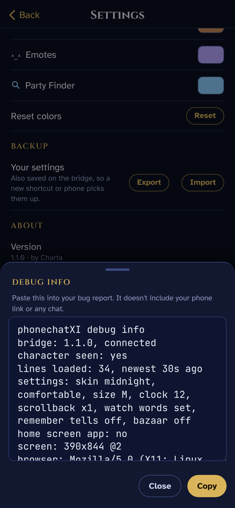

<p align="center"></p>

> [!NOTE]
> v1.0.0 was reviewed by CatsEyeXI staff and sanctioned (T1, October 2026). Their condition: *"If the addon gets any major changes (new features, automation, or anything that changes what it sends or reads), please resubmit it for review before using the updated version."*
>
> **v1.1.0 hasn't been reviewed yet.** Don't use it in game until it's released as a full release, not a pre-release. See the [changelog](CHANGELOG.md).

# phonechatXI

A second chat window for FFXI on CatsEyeXI, on your phone.

Typing with a controller is slow, and the chat log is hard to read on a Steam Deck. phonechatXI shows your chat on your phone and lets you reply with the phone's keyboard while you keep playing. The phone and the game have to be on the same Wi-Fi.

There are three parts:

- `phonechat`, an Ashita v4 addon. It writes chat to a file and types the lines you send.
- The bridge, a small Python program on the same machine as the game. It serves the phone page. It ships in the addon zip, and the addon starts it.
- The phone page. Add it to your Home Screen and it opens like an app.

Needs Ashita v4 (the CatsEye launcher), Python 3.7 or newer (already on the Steam Deck), and a phone on the same Wi-Fi. Tested on a Steam Deck with an iPhone.

<p>
  
  
  
</p>

## Features

- LS1, LS2, party, tells, say, shout, unity, yell, emotes and Party Finder in one feed, colored like the game. Apururu's Domain Invasion announcements come in on Unity.
- Views, like the game's chat windows. All, Linkshells and Party & tells are built in, and you can add your own.
- A Tells tab with a thread per person.
- Tap a name to start a tell, or a line to reply on its channel. Nothing sends until you press send.
- Linked items (`{{Suppanomimi}}`) open a BG-Wiki search.
- Mentions: words you pick, like your name, are highlighted in chat and collected in Alerts.
- The LS message of the day is pinned above chat.
- An Emotes tab with the stock emotes, plus dances, chair poses and job emotes.
- A Server tab for CatsEye `!` commands like `!points` and `!dailies`. The ones that change something ask first.
- An Alerts tab with Populox's VNM alert and a 10 minute countdown, the ventures addon's progress line, active venture seals, mentions, server notices, and bazaar visits if you turn them on. Tap × to clear a card. If CatsEye rewords a venture line, it still shows as plain text.
- An emoticon button, and emoji swap to text as you type (😀 becomes `:D`, 👀 becomes `<_<`), since the game can't show emoji.
- Three skins (Midnight, Classic, Onyx), two fonts, a compact layout, text size, 12 or 24-hour time and per-channel colors. Settings are saved on the bridge and can be exported.

<p>
  
  
  
</p>

<p>
  
  
  
  
</p>

## What it won't do

- Automate anything. Every line, emote or command is one tap from you. No auto-replies, timers, repeats or macros, and nothing reacts to chat. Mentions only highlight.
- Take game actions. `/ma`, `/ja`, `/ws`, `/item`, `/attack`, `/follow`, targeting and movement are blocked.
- Use `/yell`.
- Split messages. One tap sends one line of 130 characters at most, and no more than one line per second.
- Read the combat log.
- Replace the ventures addon. It shows that addon's progress line and nothing else.
- Talk to the internet. There's no cloud or outside server, and fonts and icons come from the bridge. The only outside page is BG-Wiki, when you tap an item.

What it can send is a fixed list: `/l`, `/l2`, `/p`, `/t`, `/s`, `/sh`, the stock emotes, and the `!` commands in [`bridge/commands.json`](bridge/commands.json). The bridge checks every line, and the addon checks it again right before typing it. The addon's check is `allowed()` in [`phonechat.lua`](addon/phonechat/phonechat.lua).

<p>
  
  
  
</p>

### New in 1.1.0 (not reviewed yet)

- Reads "X examines you", the ventures addon's progress line, Party Finder ads, the Active Venture Seals line, bazaar visits (off by default) and the LS message of the day.
- Starts and stops the bridge when you ask, and shows the QR code in an in-game window.
- Sends the same list as 1.0.0. A `;` followed by a command is now blocked.

## How it works

```
game  ->  addon  ->  feed file    ->  bridge  ->  phone
phone ->  bridge ->  outbox file  ->  addon   ->  chat (one line per tap)
```

The addon writes chat lines to a feed file, and the bridge streams them to the phone. Lines you send go into an outbox file. The addon reads it and types each line through Ashita's command queue, the same as typing it yourself. No packet injection.

The bridge lives outside the addon folder: `~/phonechat/` on the Deck, `<Ashita>\config\addons\phonechat\` on Windows. On the Deck it's a Linux program, so it can't run from inside the game's folders, and keeping it separate means addon updates don't reset your phone link.

## Install

Download `phonechatXI-v1.1.0.zip` from [Releases](../../releases). A full release is either one staff reviewed or a small fix on top of it, listed in the changelog. A pre-release hasn't been reviewed, so don't use it in game.

### Steam Deck

1. In the CatsEye launcher, use Add New Addon, pick the zip and turn it on.
2. Start the game. The phonechatXI window opens the first time. Click **Start**, and tick **Start with the game** to skip this next time.
3. Scan the QR code with your phone's camera and open the link. In Safari, tap Share, then Add to Home Screen.

The first time the addon starts the bridge, it copies it to `/home/deck/phonechat/`. A phonechatXI Bridge launcher there starts it from Desktop Mode.

If you used the old Decky plugin, uninstall it in Decky. Keep `~/phonechat`, because your link is saved there.

### Windows (untested)

Windows isn't tested or supported yet. These steps have never been run.

1. Install Python 3 from [python.org](https://www.python.org/downloads/) and tick **Add python.exe to PATH**.
2. Add the zip with the launcher's Add New Addon and turn it on.
3. In game, type `/pchat` and click **Start**. Leave the bridge window open. If Windows asks about the firewall, allow private networks.
4. Scan the QR code in the phonechatXI window.

### Updating

1. Close the game.
2. In the CatsEye launcher, use Add New Addon and pick the new zip.
3. Start the game. The addon updates the bridge the next time it starts it, either with Start with the game or when you click **Start**.

Your phone page updates itself. Nothing you've set up is lost: your phone link, your phone settings, saved tells and the addon's own settings all live in `~/phonechat/` (on Windows, `<Ashita>\config\addons\phonechat\`), which updates never touch. Only the program files are replaced. To get a new Home Screen icon, remove the shortcut and add it again.

If the bridge was running from Desktop Mode during the update, the addon tells you an update is ready. Run `/pchat stop`, then `/pchat start`.

### Uninstall

1. `/pchat stop`, then remove the addon in the launcher.
2. Delete `/home/deck/phonechat/` (Deck) or `<Ashita>\config\addons\phonechat\` (Windows).
3. Remove the shortcut from your Home Screen.

## In-game commands

| Command | |
|---|---|
| `/pchat` | Opens the phonechatXI window: start and stop, QR code, new phone link, settings. Same as `/pchat config`. |
| `/pchat help` | Prints bridge status, your phone link and these commands |
| `/pchat start`, `/pchat stop` | Starts or stops the bridge |
| `/pchat url` | Prints the phone link |
| `/pchat newlink` | Makes a new phone link. The old one stops working. |
| `/pchat debug` | Logs every chat line with its mode number, for troubleshooting |

`/pcxi` and `/phonechat` work too.

## Limits

- No push notifications. A page on your home network can't send them, so your phone won't buzz for tells.
- Safari pauses the page when the phone locks or you switch apps. It catches up when you come back, as long as the bridge kept running.
- The screen sleeps on its normal timer. Raise Auto-Lock in iPhone Settings to keep it on longer.
- If your router gives the Deck a new address, the saved link breaks. Scan the QR code again, or reserve an address for the Deck in your router (a DHCP reservation).
- Home Wi-Fi only. On public Wi-Fi, anyone with your link could read and send.

## Troubleshooting

| Problem | Fix |
|---|---|
| Phone can't connect | Check the phone is on the same Wi-Fi and the bridge is on (`/pchat`). If the address changed, scan the QR code again. On Windows, allow Python through the firewall on private networks. |
| Bridge won't start on the Deck | See `/home/deck/phonechat/bridge.log`. The error also shows in the phonechatXI window. |
| Bridge won't start on Windows | The bridge window says why. Usually Python isn't installed or isn't on PATH. |
| "Port in use" | Another bridge is running, often the old Decky one. Uninstall the Decky plugin, or `/pchat stop` and start again. |
| Bridge is on but no chat shows | Check the addon is turned on in the launcher. `/pchat debug` logs every line it sees. |
| A message says "unconfirmed" | The game didn't echo it back within a few seconds. Check in game before sending again. |
| A message says "failed" | The game rejected it, usually a tell to someone offline. |
| Someone saw your link or QR code | Make a new link in the phonechatXI window or with `/pchat newlink`. The old link stops working right away. |
| Page says "This link was replaced" | Scan the new QR code and remove the old shortcut. |
| Something else | In Settings, tap Copy debug info and paste it into a [bug report](../../issues/new/choose). |

## Privacy

- Chat is held in the bridge's memory and is gone when it stops. The feed file is cleared when the bridge starts and when the addon loads.
- Tells are saved only if you turn on Remember tells: the last 50 lines per person, deleted with Clear saved tells. No other chat is saved.
- Phone settings (views, colors, watch words) are saved on the bridge in `phone-settings.json`. No chat goes in that file.
- Anyone on your Wi-Fi with your link can read and send, so keep it to yourself. If it gets out, make a new one.

## About the code

I built this with Claude. I designed it and tested every feature myself, and I've gone through the parts that decide what gets sent, but Claude wrote most of the code and I'm not a programmer by trade. I use it daily and plan to keep it working on CatsEye. If a server or Ashita update breaks it, I'll fix it when I can, but I can't promise how fast. It's all open source, so anyone can read it or pick it up.

## Bugs and requests

phonechatXI is for chat: reading it on your phone and typing messages without fighting a controller. The emotes and server commands are there because staff reviewed them with 1.0.0, and that list isn't growing. There are no plans for more commands, addon controls or macros unless CatsEyeXI staff ask for them.

- Bugs: open a [bug report](../../issues/new/choose) and paste the text from Settings, Copy debug info. It doesn't include your phone link or any chat.
- Requests are read, but most of my time goes to fixing bugs, so I can't promise a timeline. Anything that changes what it reads from the game or sends to it needs CatsEyeXI staff review first.

To test without the game, see [`tools/`](tools): a fake chat session, and a replay of real `/pchat debug` logs through the addon.

## Credits

- Built by Charta with Claude.
- `bridge/qrcode.js` is [qrcode-generator](https://github.com/kazuhikoarase/qrcode-generator) by Kazuhiko Arase (MIT).
- The in-game QR code uses [luaqrcode](https://github.com/speedata/luaqrcode) by speedata (BSD-3), in `addon/phonechat/qrencode.lua`.
- Fonts: Cinzel, Atkinson Hyperlegible, JetBrains Mono and Cormorant SC (logo), all under the SIL Open Font License. License files are in `bridge/fonts/`.
- The server command list comes from the [CatsEyeXI Commands](https://www.bg-wiki.com/ffxi/CatsEyeXI_Commands) page on BG-Wiki.
