<p align="center">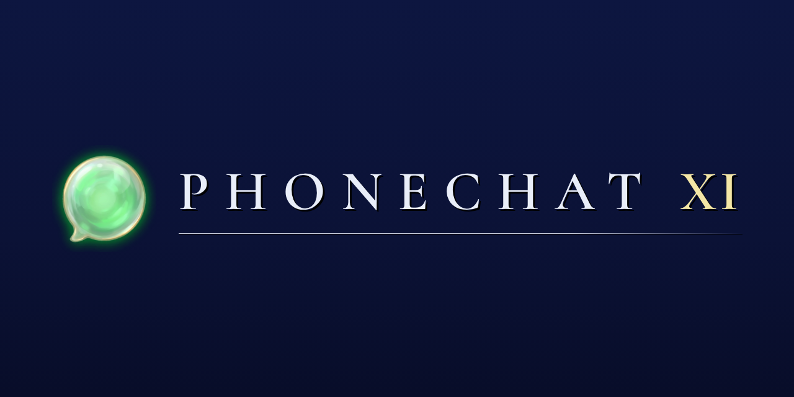</p>

> [!NOTE]
> v1.0.0 was reviewed by CatsEyeXI staff and sanctioned (T1, October 2026). Their condition: *"If the addon gets any major changes (new features, automation, or anything that changes what it sends or reads), please resubmit it for review before using the updated version."*
>
> **v1.1.0 is with CatsEyeXI staff for review.** Don't use it in game until it's a full release. See the [changelog](CHANGELOG.md).

# phonechatXI

A second chat window for FFXI on CatsEyeXI, on your phone.

Typing with a controller is slow, and the chat log is hard to read on a Steam Deck. phonechatXI shows your chat on your phone and lets you reply with the phone's keyboard while you keep playing. The phone and the game have to be on the same Wi-Fi.

There are three parts:

- `phonechat`, an Ashita v4 addon. It writes chat to a file and types the lines you send.
- The bridge, a small Python program on the same machine as the game. It serves the phone page, comes in the addon zip, and the addon starts it.
- The phone page. Add it to your Home Screen and it opens like an app.

Needs Ashita v4 (the CatsEye launcher; VanaCore's beta works too on Windows, not tested on the Steam Deck yet), Python 3.7 or newer (already on the Steam Deck), and a phone on the same Wi-Fi. Tested on a Steam Deck and on Windows 11, with an iPhone.

<p>
  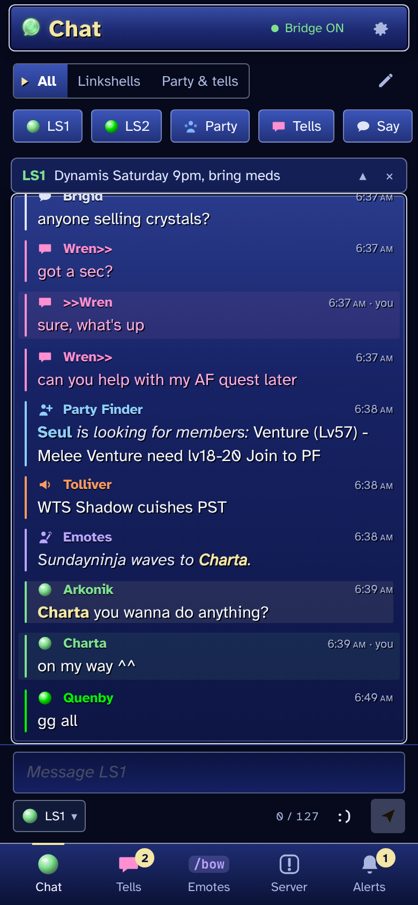
  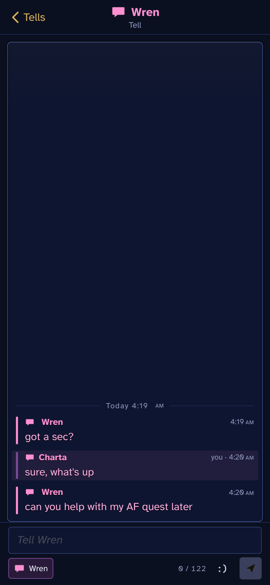
  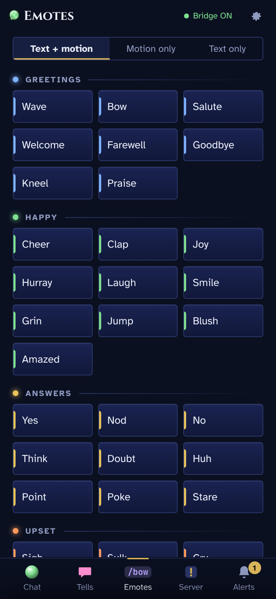
</p>

## Features

- LS1, LS2, party, tells, say, shout, unity, yell, emotes and Party Finder in one feed, colored like the game.
- Views, like the game's chat windows. All, Linkshells and Party & tells are built in, and you can add your own.
- A Tells tab with a thread per person.
- Tap a name to start a tell, or a line to reply on its channel. Nothing sends until you press send.
- Linked items (`{{Suppanomimi}}`) open a BG-Wiki search. Web addresses in chat show as plain text.
- Mentions: your name or nicknames (up to 3) are highlighted in chat and collected in Alerts. Emotes and yell don't count.
- The keyboard doesn't capitalize or autocorrect, so game words like Jeuno or Windurst come through as you typed them. Both can be turned on in Settings.
- The LS message of the day is pinned above chat.
- An Emotes tab with the stock emotes, plus dances, chair poses and job emotes.
- A Server tab with every CatsEye `!` command in a searchable list, filterable by game mode (ACE, CW, WEW). Star the ones you use. Tapping one asks before it sends, starred ones too.
- An Alerts tab: Populox's VNM alert with a 10 minute countdown, mentions, server notices and, if you turn it on, bazaar visits. Tap × to clear one.
- An emoticon button. Emoji turn into text as you type (😀 becomes `:D`, 👀 becomes `<_<`), since the game can't show them.
- Three skins (Midnight, Classic, Onyx), two fonts, a compact layout, text size, 12 or 24-hour time and per-channel colors. Settings are saved on the bridge and can be exported (without your mention names).

<p>
  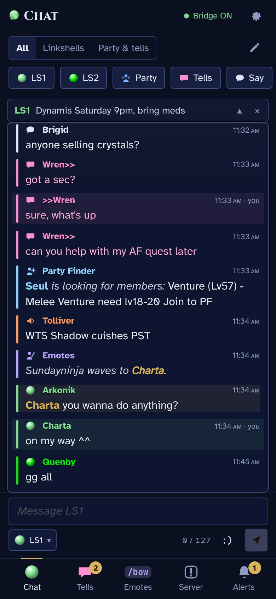
  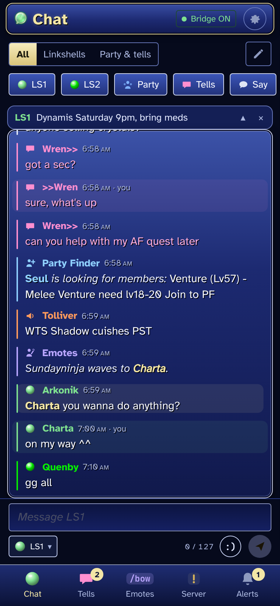
  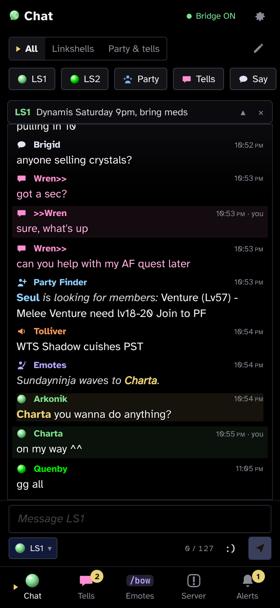
</p>

<p>
  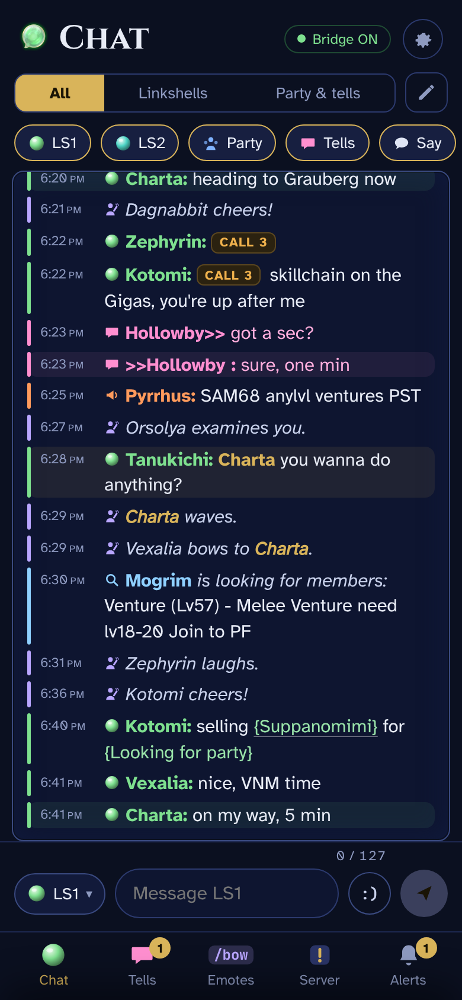
  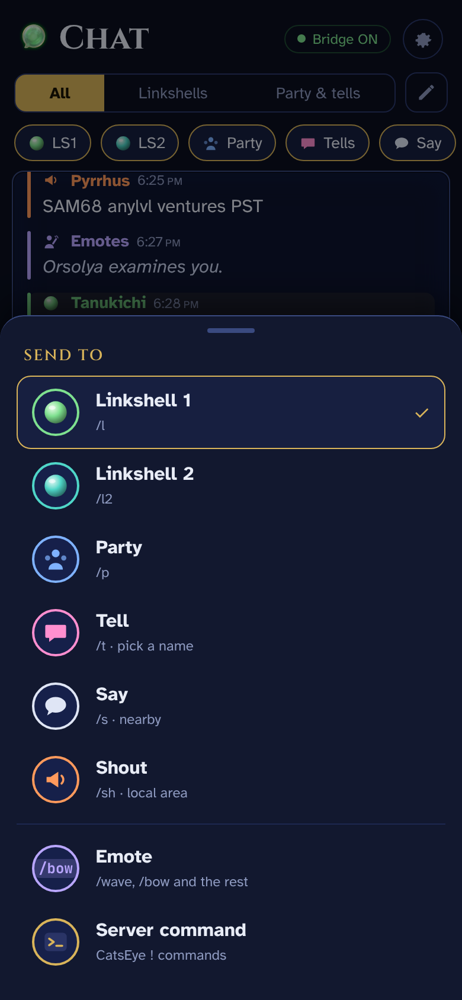
  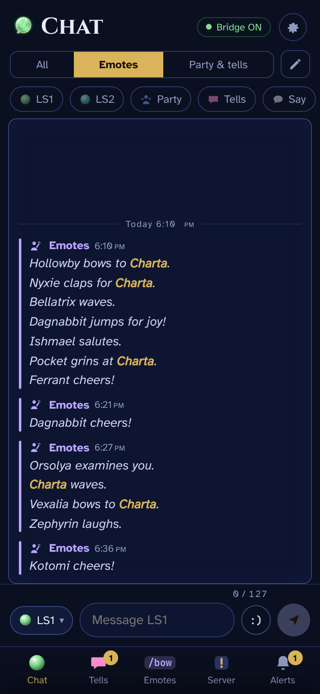
  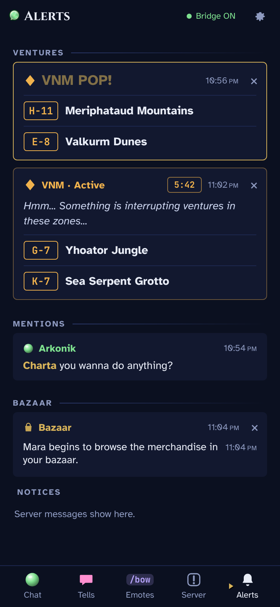
</p>

## What it won't do

- Automate anything. Every line, emote or command is one tap from you. No auto-replies, timers, repeats or macros, and nothing reacts to chat. Mentions only highlight.
- Take game actions. `/ma`, `/ja`, `/ws`, `/item`, `/attack`, `/follow`, targeting and movement are blocked, and so are target tokens like `<st>` in a chat line.
- Use `/yell`.
- Split messages. One tap sends one line of 130 bytes at most, counted on the whole typed line (so about 127 letters on a linkshell, fewer for a tell or Japanese text), and no more than one line per second.
- Read the combat log.
- Read other addons. Lines they print are ignored, the ventures addon's included.
- Go online. There's no cloud or outside server. The only outside page is BG-Wiki, when you tap an item.

What it can send is a fixed list: `/l`, `/l2`, `/p`, `/t`, `/s`, `/sh`, the stock emotes, and the `!` commands in [`bridge/commands.json`](bridge/commands.json). The bridge checks every line, and the addon checks it again against the same list right before typing it. The addon's check is `allowed()` in [`phonechat.lua`](addon/phonechat/phonechat.lua).

<p>
  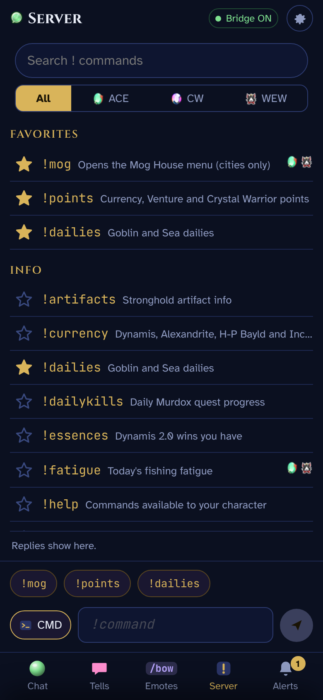
  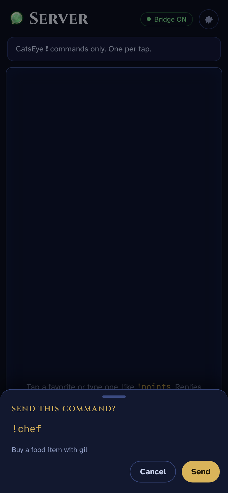
  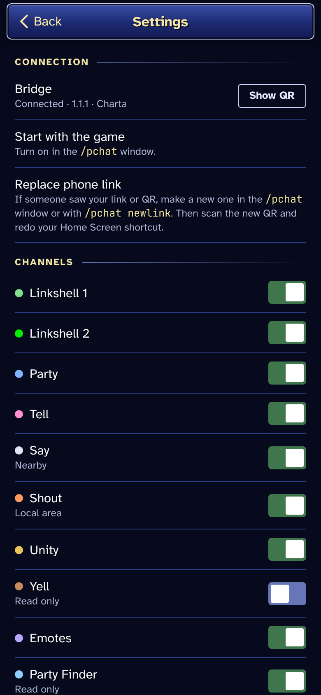
  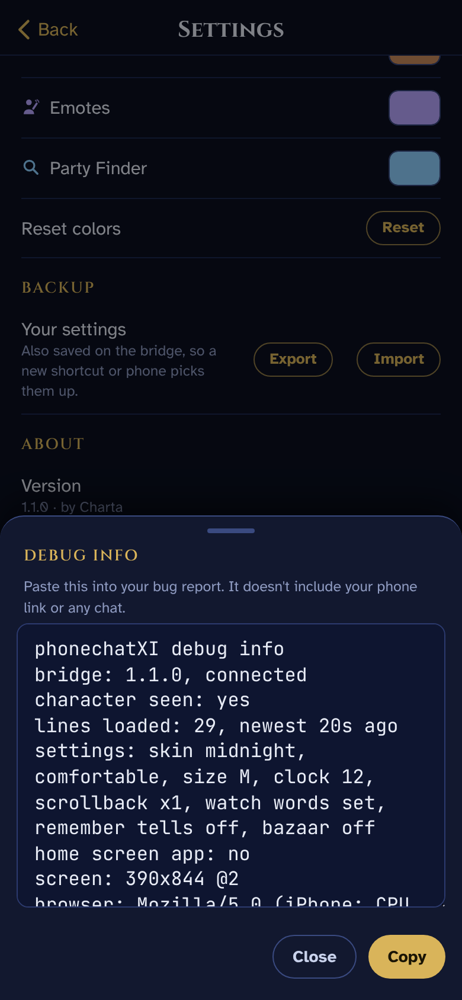
</p>

### New in 1.1.0 (not reviewed yet)

- Reads "X examines you", other players' emotes, your own shouts, Party Finder ads, bazaar visits (off by default), the LS message of the day, say lines that are just `!`, `!!` or `!?`, and replies to `!` commands you send from the phone (for 10 seconds, Server tab only).
- Sends the same list as 1.0.0, with stricter checks: a `;` followed by a command, target tokens like `<st>`, full-width lookalikes and text the game's chat box can't type are all blocked. A lone `/` (a wave) and `!`, `!!` or `!?` (reactions) can now be sent.
- Starts and stops the bridge when you ask, shows the QR code in an in-game window, and closes the bridge by itself about 100 seconds after the game is gone.

## How it works

```
game  ->  addon  ->  feed file    ->  bridge  ->  phone
phone ->  bridge ->  outbox file  ->  addon   ->  chat (one line per tap)
```

The addon writes chat lines to a feed file, and the bridge streams them to the phone. Lines you send go into an outbox file. The addon reads it and types each line through Ashita's command queue, the same as typing it yourself. No packet injection.

When the bridge runs, a small window called "phonechatXI bridge" sits next to the game (minimized on Windows). That's the local relay: it says what it is, shows your phone link, and notes when the game or a phone connects. Leave it open while you use phonechatXI. `/pchat stop` or closing the window turns phone chat off. If the game closes or freezes (or the addon is unloaded), the window and the phone say so; after 10 seconds without the game it gives you 90 seconds to close it, wait for the game to come back, or let it close by itself. A bridge started without the game (Desktop Mode, the test tools) stays open.

The bridge lives outside the addon folder: `~/phonechat/` on the Deck, `<Ashita>\config\addons\phonechat\` on Windows (`<VanaCore>\config\addons\phonechat\` on VanaCore). On the Deck it's a Linux program, so it can't run from inside the game's folders, and keeping it separate means addon updates don't reset your phone link.

## Install

Download `phonechatXI-v1.1.0.zip` from [Releases](../../releases). There's no 1.1.0 release until staff have reviewed it.

### Steam Deck

1. In the CatsEye launcher, use Add New Addon, pick the zip and turn it on.
2. Start the game. The phonechatXI window opens the first time. Click **Start**, and tick **Start with the game** to skip this next time.
3. Scan the QR code with your phone's camera and open the link. In Safari, tap Share, then Add to Home Screen.

The bridge is copied to `/home/deck/phonechat/` the first time it starts. To run it from Desktop Mode, use the phonechatXI Bridge launcher in that folder.

If you used the old Decky plugin, uninstall it in Decky. Keep `~/phonechat`, because your link is saved there.

### Windows

1. Install Python 3 from [python.org](https://www.python.org/downloads/) (any version from 3.7 up). Say yes when it offers to add Python to your PATH. Then close and reopen the CatsEye launcher, so the game sees Python.
2. Add the zip with the launcher's Add New Addon and turn it on.
3. In game, type `/pchat` and click **Start**. A small "phonechatXI bridge" window opens minimized next to the game: that's the local relay. If Windows asks about the firewall, allow private networks.
4. Scan the QR code in the phonechatXI window.

The addon puts the bridge in `<Ashita>\config\addons\phonechat\` (on VanaCore, `<VanaCore>\config\addons\phonechat\`), so you never move files by hand. Ashita and VanaCore each keep their own copy and phone link.

Tested on Windows 11 with Python 3.15, on Ashita and on VanaCore's beta: chat, tells, sending from the phone, and starting and stopping the bridge from the game. The in-game part was tested with the approved 1.0.0; 1.1's own setup steps were tested off the game until 1.1 is approved.

### Updating

1. Close the game.
2. In the CatsEye launcher, remove phonechat, then use Add New Addon and pick the new zip.
3. Start the game and the bridge as usual. The bridge updates itself.

Removing the addon doesn't lose anything. The phone page updates itself, and your link, settings and saved tells live in `~/phonechat/` (on Windows, `<Ashita>\config\addons\phonechat\`, or VanaCore's), outside the addon folder. For a new Home Screen icon, remove the shortcut and add it again.

If the bridge was running from Desktop Mode during the update, the addon tells you an update is ready. Run `/pchat stop`, then `/pchat start`.

### Uninstall

1. `/pchat stop`, then remove the addon in the launcher.
2. Delete `/home/deck/phonechat/` (Deck) or `<Ashita>\config\addons\phonechat\` (Windows; `<VanaCore>\config\addons\phonechat\` on VanaCore).
3. Remove the shortcut from your Home Screen.

## In-game commands

| Command | |
|---|---|
| `/pchat` | Opens the phonechatXI window: start and stop, QR code, new phone link, settings. Same as `/pchat config`. |
| `/pchat help` | Prints bridge status, your phone link and these commands |
| `/pchat start`, `/pchat stop` | Starts or stops the bridge |
| `/pchat url` | Prints the phone link |
| `/pchat newlink` | Makes a new phone link. The old one stops working. |
| `/pchat debug` | Logs every line the game shows, with its mode number, for troubleshooting. That includes other players' chat and combat lines, so don't post the log publicly. Your phone link is left out. |

`/pcxi` and `/phonechat` work too.

## Limits

- No push notifications. A page on your home network can't send them, so your phone won't buzz for tells.
- Safari pauses the page when the phone locks or you switch apps. It catches up when you come back, as long as the bridge kept running.
- The screen sleeps on its normal timer. Raise Auto-Lock in iPhone Settings to keep it on longer.
- If your router gives your Deck or PC a new address, the saved link breaks. Scan the QR code again, or reserve an address for it in your router (a DHCP reservation).
- One character at a time. If two characters are logged in and both have chat, sending pauses so a line can't come from the wrong one. It resumes about 5 minutes after only one has chat.
- Home Wi-Fi only. The link and chat aren't encrypted, so on public Wi-Fi anyone on the network could see them, and anyone with your link could read and send.

## Troubleshooting

| Problem | Fix |
|---|---|
| Phone can't connect | Check the phone is on the same Wi-Fi and the bridge is on (`/pchat`). If the address changed, scan the QR code again. On Windows, allow Python through the firewall on private networks. |
| Bridge won't start on the Deck | See `/home/deck/phonechat/bridge.log`. The error also shows in the phonechatXI window. |
| Bridge won't start on Windows | The bridge window says why. Usually Python isn't installed or isn't on PATH. |
| "Port in use" | Another bridge is running, often the old Decky one. Uninstall the Decky plugin, or `/pchat stop` and start again. |
| Bridge is on but no chat shows | Check the addon is turned on in the launcher. `/pchat debug` logs every line it sees. |
| A line says "The game didn't confirm this one" | The game didn't echo it back within a few seconds. Check in game before sending it again. |
| Phone says "waiting for the game" on Windows | The bridge and the addon are using different folders. The bridge window's Folder line should match the folder at the bottom of the `/pchat` window (`<Ashita>\config\addons\phonechat`, or VanaCore's). If you copied a Deck install, delete `dir.txt` from the addon folder and `bridge\config.json`, then `/addon reload phonechat` and `/pchat start`. |
| A line shows a red error from the game | The game rejected it, usually a tell to someone offline or a party line with no party. The phone shows the game's own message. |
| "Sending is paused" | Two of your characters are logged in. Log one out; sending resumes about 5 minutes after it last had chat. |
| Someone saw your link or QR code | Make a new link in the phonechatXI window or with `/pchat newlink`. The old link stops working right away. |
| Page says "This link was replaced" | Scan the new QR code and remove the old shortcut. |
| Something else | In Settings, tap Copy debug info and paste it into a [bug report](../../issues/new/choose). |

## Privacy

- Chat is held in the bridge's memory and is gone when it stops. On its way to the bridge it goes through a feed file, and lines you send go through an outbox file, both in the phonechat folder. They stay there after you stop until the bridge next starts, which empties them. The addon also empties its feed file when it loads.
- Tells are saved only if you turn on Remember tells: the last 50 lines per person, deleted with Clear saved tells. No other chat is saved.
- Phone settings (views, colors, skins, favorites) are also saved on the bridge in `phone-settings.json`, so a new shortcut picks them up. Your mention names, who you've had tells with, and the alert cards you've dismissed stay on the phone only. They're never sent to the bridge or put in an export file, so a new phone or shortcut needs your name typed again. No chat goes in that file.
- Anyone on your Wi-Fi with your link can read and send, so keep it to yourself. If it gets out, make a new one.

## About the code

I built this with Claude. I designed it and tested every feature myself, and I've gone through the parts that decide what gets sent, but Claude wrote most of the code and I'm not a programmer by trade. I use it daily and plan to keep it working on CatsEye. If a server or Ashita update breaks it, I'll fix it when I can, but I can't promise how fast. It's all open source, so anyone can read it or pick it up.

### If you change it or fork it

You're welcome to. Please:

- **Test off the live server.** [`tools/`](tools) runs the addon without the game.
- **Get new features reviewed.** If your version reads or sends anything new, or does anything on its own, it's a new addon. Give it its own name and submit it to CatsEyeXI staff through a GM ticket before using it in game.
- **Approval doesn't carry over.** It covers the versions staff reviewed from this repo, not changed copies.

Not sure if a change counts? Ask staff first.

## Bugs and requests

phonechatXI is for chat: reading it on your phone and typing messages without fighting a controller. The emotes and server commands are there because staff reviewed them with 1.0.0, and that list isn't growing. There are no plans for more commands, addon controls or macros unless CatsEyeXI staff ask for them.

- Bugs: open a [bug report](../../issues/new/choose) and paste the text from Settings, Copy debug info. It doesn't include your phone link or any chat.
- Requests are read, but most of my time goes to fixing bugs, so I can't promise a timeline. Anything that changes what it reads from the game or sends to it needs CatsEyeXI staff review first.

To test without the game, see [`tools/`](tools): a fake chat session, and a replay of real `/pchat debug` logs through the addon.

## Credits

- Built by Charta with Claude.
- `bridge/qrcode.js` is [qrcode-generator](https://github.com/kazuhikoarase/qrcode-generator) by Kazuhiko Arase (MIT).
- The in-game QR code uses [luaqrcode](https://github.com/speedata/luaqrcode) by speedata (BSD-3), in `addon/phonechat/qrencode.lua`.
- Fonts: Cinzel, Atkinson Hyperlegible, JetBrains Mono and Cormorant SC (logo), all under the SIL Open Font License. License files are in `bridge/fonts/`.
- The server command list and the game mode icons come from the [CatsEyeXI Commands](https://www.bg-wiki.com/ffxi/CatsEyeXI_Commands) page on BG-Wiki (as of October 2026).
