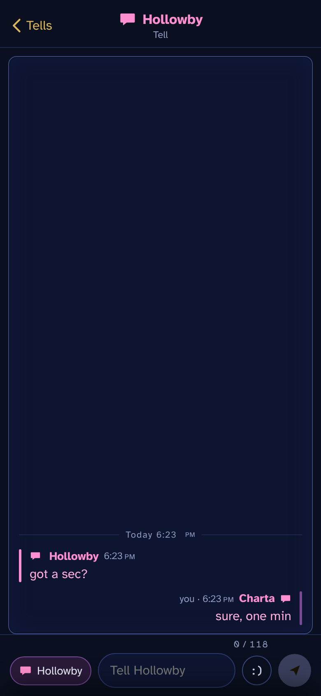
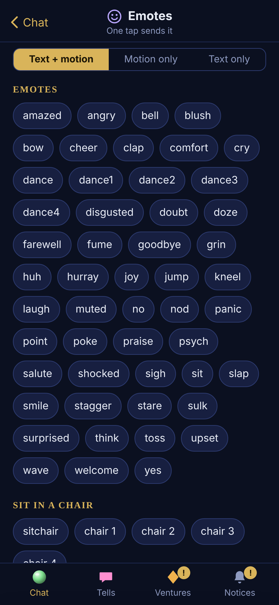
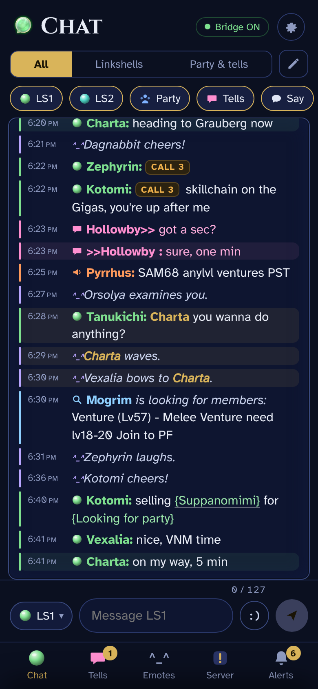
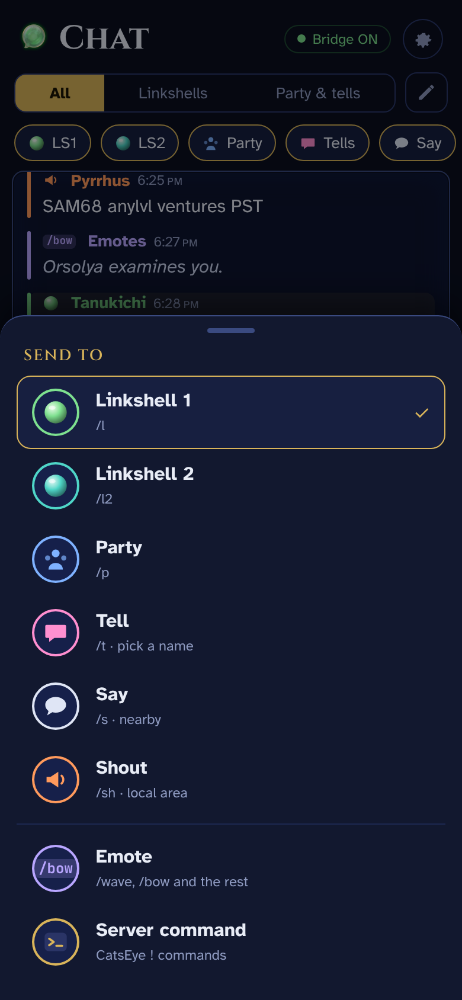
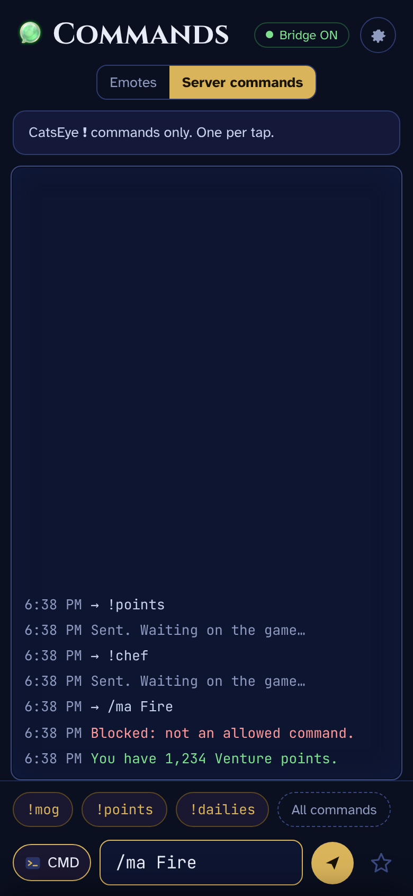
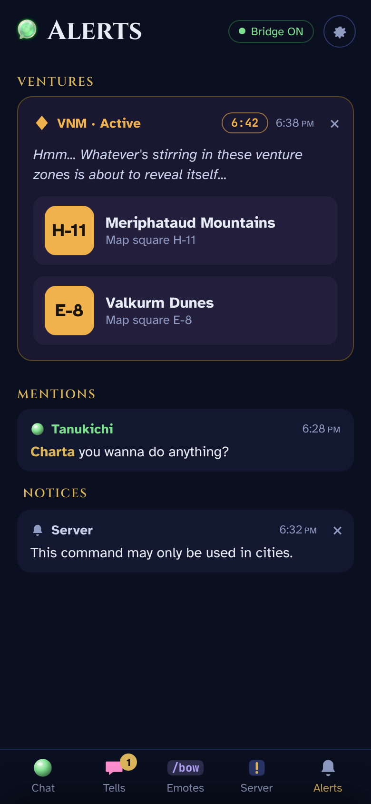
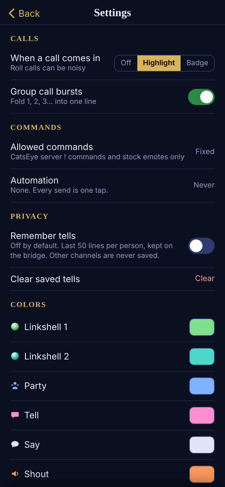
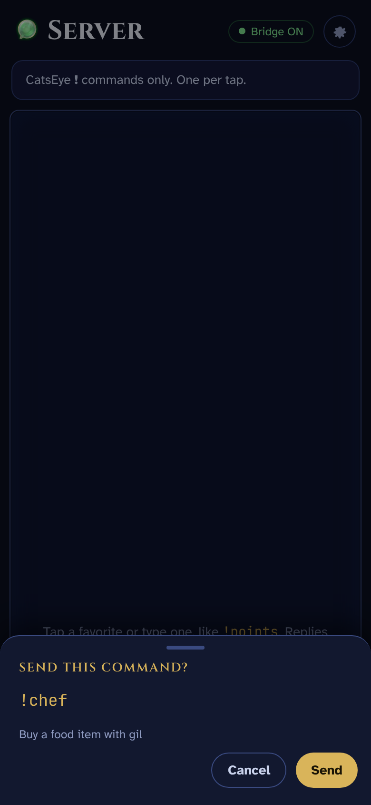

> [!CAUTION]
> **UNDER REVIEW: NOT APPROVED TO USE.**
> phonechatXI is waiting on a CatsEyeXI staff review. Don't install or run it until it's approved. This page will say so when it is.

# phonechatXI

**Your phone as a second chat window for FFXI on CatsEyeXI.**

FFXI's chat is hard to read and type in with a controller, especially on a Steam Deck. phonechatXI puts your chat on your phone, so you can read LS, party, tells and the rest, and reply with a real keyboard, while you keep playing on the main screen. It's meant to be used alongside the game, on the same Wi-Fi network.

<p>
  
  
  
</p>

## What it does

- **One feed for all your chat:** LS1, LS2, party, tells, say, shout, unity and yell, color-coded like the game. Linkshells get linkpearl icons.
- **Your own views,** like the game's chat windows. "All", "Linkshells" and "Party & tells" come built in, and you can make your own and pick which channels show in each.
- **Tells get their own tab,** with a thread per person.
- **Reply** to LS1, LS2, party, tells, say and shout.
- **Emotes in one tap.** Every stock emote, chair poses and job emotes, with or without the motion.
- **CatsEye server commands** like `!points`, `!dailies` and `!mog`, with favorites. Commands that change something ask you to confirm first.
- **Venture alerts** from Populox become a card with the zones and map squares.
- **`<call>` tags** show as a small badge, and roll calls fold into one line.
- **Comfortable or compact layout,** text size, and a color picker per channel.

<p>
  
  
  
  
</p>

## What it will never do

- **No automation.** Every message, emote or command is one tap from you. No auto replies, nothing that reacts to chat, no timers, repeats or macros.
- **No game actions.** `/ma`, `/ja`, `/ws`, `/item`, `/attack`, `/follow`, targeting and movement are all blocked.
- **No yell.**
- **No flooding.** One tap sends one line, and each line has to fit the normal 130 character chat limit. Messages are never split into several sends. At most one line per second.
- **No combat log.** Battle messages are never captured.
- **Nothing leaves your home network.** No cloud, no outside server.

Everything it's allowed to send is on a fixed list, checked twice: once by the bridge and again by the addon right before it types the line. If you want to check the list yourself, it's `allowed()` in [`addon/phonechat/phonechat.lua`](addon/phonechat/phonechat.lua) and [`bridge/commands.json`](bridge/commands.json).

<p>
  
  
</p>

## How it works

```
game  ->  addon  ->  feed file  ->  bridge  ->  your phone
phone ->  bridge ->  outbox file ->  addon  ->  chat  (one line per tap)
```

- **Addon** ([`addon/phonechat`](addon/phonechat), Ashita v4): reads chat and writes it to a file. When you send from your phone, it types that one line through Ashita's normal command queue, same as typing it yourself. No packet injection.
- **Bridge** ([`bridge/`](bridge), Python, no extra packages): serves the phone page on your home Wi-Fi.
- **Decky plugin** ([`decky/`](decky), Steam Deck only): turns the bridge on and off in Game Mode and shows a QR code to scan. It also installs and updates the bridge for you.

## Install

### Steam Deck

1. **Decky plugin:** in Decky, open Developer and use "Install Plugin from ZIP" with `phonechatXI-decky-v1.zip` from the [releases](../../releases). It sets the bridge up in `/home/deck/phonechat/bridge/`.
2. **Addon:** copy `addon/phonechat/` into your Ashita `addons/` folder, including `dir.txt` (it holds `Z:\home\deck\phonechat\`). Keep a copy somewhere else, since the CatsEye launcher updates the addons folder.
3. **Load it:** add `/addon load phonechat` at the end of `scripts/default.txt`, or type it in game. You'll see a green or red "Phone chat bridge" line.
4. **Phone:** turn the bridge on in the Decky panel, scan the QR, and add the page to your home screen.

**Desktop Mode or any Linux:** run `./start.sh` in the bridge folder instead (add `--port 8780` if 8765 is taken). Open `http://localhost:8765/setup` on that computer for the QR.

### Windows (written for it, not tested yet)

1. Install Python 3 from python.org and tick "Add to PATH".
2. Put the `bridge` folder and `start-bridge.bat` in `<Ashita>\config\addons\phonechat\`. No `dir.txt` needed.
3. In game, `/pchat start` opens the bridge in a small window. Allow it through the firewall on private networks.
4. Open `http://localhost:8765/setup` on the PC and scan the QR.

## In game

| Command | What it does |
|---|---|
| `/pchat` | Bridge status, your phone link, and the list of options |
| `/pchat url` | Print the phone link |
| `/pchat start` / `stop` | Start (Windows) or stop the bridge |
| `/pchat config` | Settings window |
| `/pchat debug` | Log every chat line with its mode number, for troubleshooting |

`/pcxi` works too.

## Privacy

- Chat lives in the bridge's memory and is gone when it stops. The chat file it reads from is cleared every time the bridge starts and every time the addon loads.
- Only tells can be saved, and only if you turn on "Remember tells". That keeps the last 50 lines per person, and "Clear saved tells" deletes them. Linkshell and party chat are never saved.
- Anyone on your Wi-Fi with your link can read and send, so keep your link to yourself.

## Credits

- Built with help from Claude.
- `bridge/qrcode.js` is [qrcode-generator](https://github.com/kazuhikoarase/qrcode-generator) by Kazuhiko Arase (MIT).
- The Decky plugin started from the Decky plugin template (BSD-3).
- Server command list from the [CatsEyeXI Commands](https://www.bg-wiki.com/ffxi/CatsEyeXI_Commands) page on BG-Wiki.
